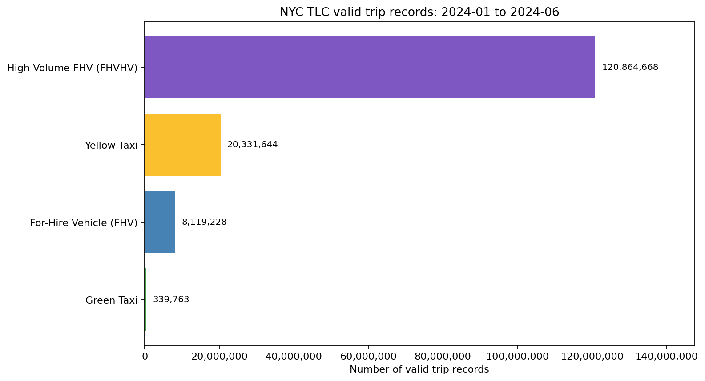
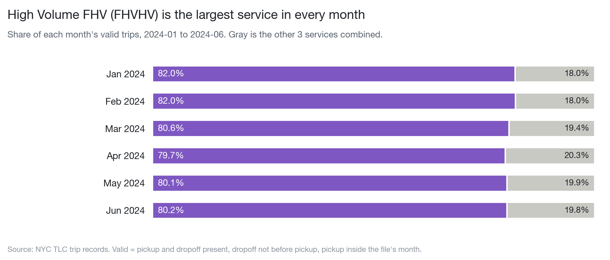
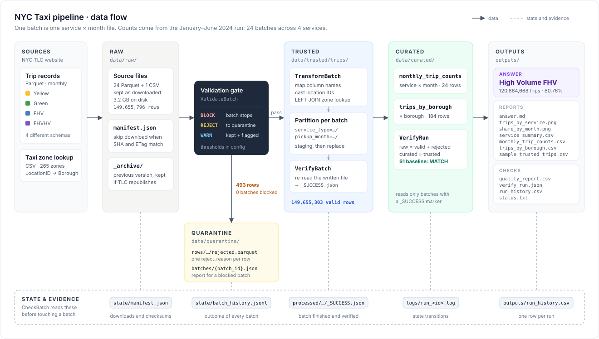
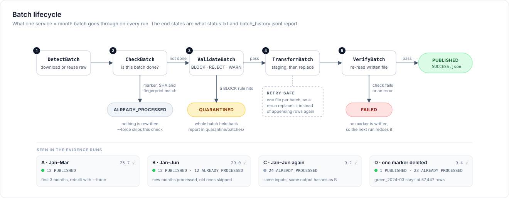

# CS341 Mission B: NYC Taxi — Submission 2

นายปพนพัชร์ มีวน — 6709650458

[](https://github.com/zero-h0ur/CS341-Submission2_NYC-Taxi-Pipeline/actions/workflows/tests.yml)

**สารบัญ:** [คำตอบ](#คำถามและคำตอบ) · [ข้อมูลที่ใช้](#ข้อมูลที่ใช้) · [Pipeline](#pipeline) · [โครงสร้าง repo](#โครงสร้าง-repository) · [ติดตั้งและรัน](#ติดตั้งและรัน) · [Data quality](#data-quality-และผลจริง) · [ผลลัพธ์](#ผลลัพธ์และการตรวจสอบ) · [หลักฐานรันซ้ำ](#หลักฐานรันซ้ำและอัปเดต) · [Tests และ CI](#tests-และ-ci) · [การตัดสินใจ](#การตัดสินใจในการออกแบบ) · [เทียบกับ AWS](#เทียบกับแนวคิด-aws-ในวิชา) · [S1 → S2](#s1-พัฒนาเป็น-s2-อย่างไร) · [ข้อจำกัด](#ข้อจำกัด) · [Reflection](#learning-reflection) · [การใช้ AI](#การใช้-ai-และการตรวจสอบ)

## คำถามและคำตอบ

**Which taxi type was the most used in the first half of 2024?**

ผมใช้จำนวน valid trip records เป็นตัววัด โดยหนึ่งแถวแทนหนึ่ง trip record และใช้เงื่อนไขเดียวกับ Submission 1 ได้แก่ มี pickup และ dropoff, dropoff ไม่ก่อน pickup และ pickup อยู่ในเดือนของไฟล์

ผลจากการรันข้อมูลมกราคม–มิถุนายน 2024 คือ **High Volume FHV (FHVHV) มีจำนวนมากที่สุด 120,864,668 valid trips หรือ 80.76%**

| ประเภทบริการ | Raw records | Valid trips | Rejected | สัดส่วน valid |
|---|---:|---:|---:|---:|
| FHVHV | 120,864,668 | 120,864,668 | 0 | 80.76% |
| Yellow | 20,332,093 | 20,331,644 | 449 | 13.59% |
| FHV | 8,119,228 | 8,119,228 | 0 | 5.43% |
| Green | 339,807 | 339,763 | 44 | 0.23% |
| รวม | 149,655,796 | 149,655,303 | 493 | |

ตัวเลขมาจาก [service_summary.csv](outputs/service_summary.csv), [quality_report.csv](outputs/quality_report.csv) และ [verify_run.json](outputs/verify_run.json) ซึ่งเทียบทั้ง raw และ valid counts กับ S1 ได้ `MATCH` ทุกประเภท



แยกดูรายเดือนแล้ว FHVHV ก็ยังมากที่สุดทุกเดือน สัดส่วนอยู่ระหว่าง 79.7% ถึง 82.0% คำตอบจึงไม่ได้มาจากเดือนใดเดือนหนึ่ง



[คำตอบฉบับเต็ม](outputs/answer.md)

## ข้อมูลที่ใช้

ผมใช้ข้อมูลหลายชุดจาก NYC TLC ได้แก่ Parquet รายเดือนของสี่ประเภทบริการ และ CSV สำหรับจับคู่ Location ID กับ borough โดยเลือกไฟล์มกราคม–มิถุนายน 2024 รวม 24 monthly batches

| ชุดข้อมูล | รูปแบบ | URL pattern | Pickup / Dropoff |
|---|---|---|---|
| Yellow | Parquet | `https://d37ci6vzurychx.cloudfront.net/trip-data/yellow_tripdata_{YYYY-MM}.parquet` | `tpep_pickup_datetime` / `tpep_dropoff_datetime` |
| Green | Parquet | `https://d37ci6vzurychx.cloudfront.net/trip-data/green_tripdata_{YYYY-MM}.parquet` | `lpep_pickup_datetime` / `lpep_dropoff_datetime` |
| FHV | Parquet | `https://d37ci6vzurychx.cloudfront.net/trip-data/fhv_tripdata_{YYYY-MM}.parquet` | `pickup_datetime` / `dropOff_datetime` |
| FHVHV | Parquet | `https://d37ci6vzurychx.cloudfront.net/trip-data/fhvhv_tripdata_{YYYY-MM}.parquet` | `pickup_datetime` / `dropoff_datetime` |
| Taxi zone lookup | CSV | [taxi_zone_lookup.csv](https://d37ci6vzurychx.cloudfront.net/misc/taxi_zone_lookup.csv) | `LocationID` → `Borough` |

หนึ่ง batch คือ service × month เช่น `green_2024-03` ส่วน `run_id` ระบุการสั่งรันแต่ละครั้ง URL, size, ETag, SHA-256 และเวลารับไฟล์อยู่ใน manifest; snapshot ที่ใช้ส่งอยู่ใน [source_manifest.json](evidence/source_manifest.json)

## Pipeline



[State machine และรายละเอียดการ publish](docs/pipeline.md)

Raw เก็บไฟล์ต้นฉบับ Trusted เก็บ valid trips ใน schema กลางพร้อม borough และ warning flags ส่วน curated เปลี่ยนเป็นตารางสรุปสำหรับวิเคราะห์ ผมใช้ `Unknown` แทน pickup borough ที่หาไม่ได้ในการรวมยอด เพื่อรักษาจำนวนเที่ยวทั้งหมด

## โครงสร้าง repository

```text
config/pipeline.yaml       source mappings, paths, thresholds, DuckDB settings
taxi_pipeline/
  __main__.py              CLI
  config.py                configuration and DuckDB connection
  ingest.py                source detection, download, archive, manifest
  quality.py               validation, standardization, quarantine
  transform.py             LEFT JOIN and partition replacement
  verify.py                batch and run verification
  curate.py                monthly and borough tables
  pipeline.py              local orchestration
  state.py                 marker, audit history, run log, status
  report.py                analysis, chart, sample, evidence snapshots
scripts/verify_reruns.py   C–D experiment and evidence report
scripts/demo_blocked_batches.py
                           E: broken files made from a real raw file
tests/                    generated fixtures and HTTP simulation
.github/workflows/        GitHub Actions tests
docs/                     data contract, pipeline notes, evidence results
docs/images/              pipeline overview and batch lifecycle diagrams
outputs/                  selected results from actual runs
evidence/                 A–E snapshots, logs, manifests, test and CI results
submission1/              S1 notebook used as the baseline
```

`data/`, `state/` และ `logs/` เป็นข้อมูลบนเครื่องที่อยู่ใน `.gitignore` ผมเก็บตัวอย่างและหลักฐานที่เลือกแล้วใน `outputs/` และ `evidence/`

## ติดตั้งและรัน

ใช้ Python 3.10 ขึ้นไป รันได้ทั้ง macOS, Linux และ Windows (run lock ใช้ `fcntl` หรือ `msvcrt` ตาม OS) ผลบนเครื่องผมใช้ Python 3.13.13, DuckDB 1.4.2, pandas 2.3.3 และ PyArrow 22.0.0 ตาม [requirements.txt](requirements.txt)

```bash
git clone https://github.com/zero-h0ur/CS341-Submission2_NYC-Taxi-Pipeline.git
cd CS341-Submission2_NYC-Taxi-Pipeline
python3 -m venv .venv
source .venv/bin/activate
python -m pip install --only-binary=:all: -r requirements.txt
python -m taxi_pipeline config
python -m taxi_pipeline run --start 2024-01 --end 2024-06
python -m taxi_pipeline status
```

บน Windows ใช้ PowerShell:

```powershell
git clone https://github.com/zero-h0ur/CS341-Submission2_NYC-Taxi-Pipeline.git
cd CS341-Submission2_NYC-Taxi-Pipeline
py -m venv .venv
.venv\Scripts\Activate.ps1
python -m pip install --only-binary=:all: -r requirements.txt
python -m taxi_pipeline run --start 2024-01 --end 2024-06
python -m taxi_pipeline status
```

คำสั่งหลักดาวน์โหลด source ที่ต้องใช้ ประมวลผล batch สร้าง curated ตรวจผล และเขียนรายงาน เมื่อตรวจไม่ผ่านจะคืน exit code ที่ไม่ใช่ศูนย์

```bash
python -m taxi_pipeline run --start 2024-01 --end 2024-06 --ingest-only
python -m taxi_pipeline run --start 2024-01 --end 2024-03 --validate-only
python -m taxi_pipeline run --start 2024-03 --end 2024-03 --services green --force
```

`--ingest-only` รับไฟล์เข้า raw ส่วน `--validate-only` ตรวจ raw ที่มีอยู่โดยไม่เรียก network สำหรับการรับข้อมูล `--force` ใช้กับ full run เพื่อประมวลผล batch ที่เลือกใหม่ผ่าน gate เดิม

ผมตั้ง DuckDB `memory_limit=2GB`, `threads=2` และ `temp_directory=data/_duckdb_tmp` ใน [config](config/pipeline.yaml) ค่านี้เป็นขีดจำกัดภายใน DuckDB ไม่ใช่ผลวัด RAM สูงสุดของทั้ง process

## Data quality และผลจริง

| ระดับ | กติกา | การทำงาน |
|---|---|---|
| BLOCK | อ่าน Parquet ไม่ได้, ไม่มีแถว, ขาดคอลัมน์ที่ต้องใช้, timestamp type ไม่ตรง contract | เก็บ batch report และหยุด batch |
| BLOCK | pickup นอกเดือนมากกว่า 1% หรือ valid ratio น้อยกว่า 99% | ไม่ publish trusted ของ batch นี้ |
| REJECT ROW | missing pickup, missing dropoff, dropoff ก่อน pickup, pickup นอกเดือน | เก็บแถวพร้อมเหตุผลหลักหนึ่งค่าใน quarantine |
| STANDARDIZE | ชื่อเวลาต่างกัน, Location ID ต่าง type | map ชื่อและ cast ID เป็น INTEGER |
| WARN | duration มากกว่า 1,440 นาที, duration เป็นศูนย์, location เป็น null หรือไม่อยู่ใน lookup | เก็บ valid row พร้อม flag |

เหตุผลหลักของ rejected row ใช้ลำดับ missing pickup → missing dropoff → dropoff ก่อน pickup → pickup นอกเดือน เพื่อไม่ให้นับ rejected ซ้ำ ส่วนจำนวนแถวนอกเดือนสำหรับ BLOCK นับแยกจากเหตุผลหลัก

ผลจริงไม่มี missing pickup/dropoff ที่ถูก reject; พบ dropoff ก่อน pickup 300 แถว และ pickup นอกเดือน 193 แถว รวม rejected 493 แถว Yellow มี rejected 449 แถว และ Green 44 แถว

| Warning | จำนวน valid rows ที่ติด flag |
|---|---:|
| Long trip | 2,330 |
| Zero duration | 6,224 |
| Unknown location | 6,430,010 |
| มี warning อย่างน้อยหนึ่ง flag | 6,437,742 |

Flags ซ้อนกันได้จึงนำแต่ละแถวมาบวกเป็นยอด unique ไม่ได้ Unknown location อยู่ใน FHV ทั้งหมดตามผลรอบนี้ ผมเก็บแถวเหล่านี้ไว้เพราะ metric ใช้กติกาเวลาและเดือนของ S1

[Data contract และ nullable fields](docs/data_contract.md)

## ผลลัพธ์และการตรวจสอบ

| Output | ระดับข้อมูล / หน้าที่ |
|---|---|
| [monthly_trip_counts.csv](outputs/monthly_trip_counts.csv) | service–month, จำนวน valid trips; ครบ 24 แถว |
| [trips_by_borough.csv](outputs/trips_by_borough.csv) | service–month–pickup borough รวม Unknown |
| [service_summary.csv](outputs/service_summary.csv) | รวมหกเดือนและคำนวณสัดส่วน |
| [trips_by_service.png](outputs/trips_by_service.png) | กราฟยอดรวมราย service |
| [share_by_month.png](outputs/share_by_month.png) | สัดส่วนของบริการอันดับหนึ่งในแต่ละเดือน |
| [sample_trusted_trips.csv](outputs/sample_trusted_trips.csv) | ตัวอย่าง 1,000 trips จากแต่ละ batch, 14 คอลัมน์ |
| [quality_report.csv](outputs/quality_report.csv) | ผล gate, reject และ warning ราย batch |
| [verify_run.json](outputs/verify_run.json) | ยอด raw/trusted/curated, baseline และ artifact SHA-256 |
| [run_history.csv](outputs/run_history.csv) | สถานะ เวลา และจำนวน batch ของแต่ละ run |
| [status.txt](outputs/status.txt) | สถานะล่าสุดจาก marker และ history |

Parquet ของ curated อยู่ที่ `data/curated/monthly_trip_counts.parquet` และ `data/curated/trips_by_borough.parquet` และสร้างใหม่ได้จาก CLI ตัวอย่าง CSV ที่ commit มาจากตารางเหล่านี้

VerifyBatch ตรวจข้อมูลหลังเขียนก่อนสร้าง `_SUCCESS` ส่วน VerifyRun ตรวจว่า raw = valid + rejected ทุก batch, curated ตรงกับ trusted ราย service–month, ยอด borough รวมเท่ากัน และมีทุก service–month ตาม window เมื่อครบช่วง baseline จะตรวจเทียบ S1 ทั้ง raw และ valid counts

ระบบเขียน `verify_run.json` เป็น `passed=false` ตอนเริ่ม full run และเปลี่ยนเป็น `PASSED` หลังตรวจและเผยแพร่ artifacts ครบ หากรอบใหม่ล้มเหลว ผลเก่าที่อยู่บนเครื่องต้องอ่านร่วมกับสถานะและ run ID ในไฟล์นี้

## หลักฐานรันซ้ำและอัปเดต



[ผล A–D พร้อมเวลาและจำนวน batch จริง](docs/rerun_evidence.md)

- A: สร้างมกราคม–มีนาคมใหม่ด้วย controlled `--force`
- B: ขยายถึงมิถุนายน โดยข้าม batch ที่สำเร็จแล้ว
- C: รันช่วงหกเดือนเดิมซ้ำและเทียบ SHA ของตารางวิเคราะห์กับ B
- D: ลบเฉพาะ marker ของ Green มีนาคม แล้วตรวจจำนวนแถวก่อน/หลังและ SHA ของตารางวิเคราะห์
- E: ทำไฟล์เสียสองแบบจากไฟล์จริง `green_2024-03` แล้วรันแบบ `--validate-only` ใน workspace แยก (ดูด้านล่าง)

```bash
python -m scripts.verify_reruns
```

คำสั่งนี้ใช้หลังมี snapshot A–B และ trusted ครบหกเดือนแล้ว เก็บ C–D และรายงานจากค่าที่รันจริง; หากมี C–D ที่ผ่านแล้วจะใช้หลักฐานเดิม

### E: ไฟล์เสียต้องไม่ผ่าน gate

A–D ไม่มี batch ไหนโดน BLOCK เพราะข้อมูลจริงทั้ง 24 ไฟล์ผ่านเกณฑ์ ผมจึงทำ E เพื่อดูว่า gate หยุดไฟล์เสียได้จริงกับข้อมูล TLC ไม่ใช่แค่ใน fixture

| Batch | ไฟล์ที่ใส่เข้าไป | ผล | เหตุผลจาก gate |
|---|---|---|---|
| green_2024-04 | ไฟล์มีนาคมที่ตั้งชื่อเป็นเมษายน | QUARANTINED | pickup นอกเดือน 57,456 จาก 57,457 แถว |
| green_2024-05 | ไฟล์มีนาคมที่ไม่มี `lpep_dropoff_datetime` | QUARANTINED | `missing_columns` |

```bash
python -m scripts.demo_blocked_batches
```

สคริปต์สร้าง workspace ที่ `data/_demo/run_E` แยก config, state และ outputs ของตัวเอง จึงไม่โหลดไฟล์ใหม่และไม่แตะ trusted หรือ history ของโปรเจกต์จริง จำนวนบรรทัดใน `state/batch_history.jsonl` ก่อนและหลังรันถูกบันทึกไว้ใน [run_summary.json](evidence/E/run_summary.json) พร้อม [quality report](evidence/E/quality_report.csv), [log](evidence/E/run.log) และรายงาน quarantine ของ [green_2024-04](evidence/E/quarantine_green_2024-04.json) กับ [green_2024-05](evidence/E/quarantine_green_2024-05.json)

[Batch audit trail](evidence/batch_history.jsonl), [source manifest](evidence/source_manifest.json) และ [การทดลอง marker หายใน Phase 3](evidence/phase3_marker_loss.json)

## Tests และ CI

```bash
python -m pytest -q --junitxml=evidence/pytest_results.xml
```

ผลบนเครื่องผมผ่าน 31 tests ตาม [JUnit report](evidence/pytest_results.xml) Tests สร้าง Parquet/CSV ใน `tmp_path` และจำลอง HTTP โดยบล็อก HTTP จริง ครอบคลุม rule counts, mapping, BLOCK, ขอบเขต threshold, retry, source/reference เปลี่ยน, marker หาย, partial failure, baseline mismatch, path symlink และ run lock ทั้งแบบ macOS/Linux และ Windows

[GitHub Actions](https://github.com/zero-h0ur/CS341-Submission2_NYC-Taxi-Pipeline/actions/workflows/tests.yml) รันทุก push บน Ubuntu (Python 3.10, 3.13) และ Windows (Python 3.13) ผลรันที่บันทึกไว้ก่อนเพิ่ม Windows อยู่ใน [CI snapshot](evidence/ci_run.json)

CI ตรวจพฤติกรรมด้วย fixture ส่วนหลักฐาน A–E ตรวจผลกับข้อมูล TLC จริง

## การตัดสินใจในการออกแบบ

1. **คงนิยาม valid ของ S1** ผมใช้กติกาเดียวกันเพื่อเทียบ baseline ได้ Zero duration และ outlier จึงเป็น warning ตามเงื่อนไขที่กำหนด ผล valid counts ของทุกประเภทตรงกับ S1
2. **ใช้ batch, marker และ replace ร่วมกัน** Marker ช่วยข้ามงานสำเร็จ ส่วนการ replace ไฟล์เดียวต่อ partition ช่วยให้ retry หลังเขียนข้อมูลแต่ยังไม่มี marker ไม่เพิ่ม trip เดิมซ้ำ
3. **แยก zones และ quarantine** ผมเก็บ source ไว้ใน raw เพื่อย้อนตรวจได้ แยก trusted ที่ผ่าน gate และใช้ curated สำหรับสรุปผล แถว rejected มีเหตุผลและไฟล์ให้ตรวจ
4. **ใช้ DuckDB บนเครื่องเดียว** งานจริงมี valid records รวม 149,655,303 แถว ผมให้ DuckDB query Parquet และใช้ pandas เฉพาะตารางสรุปขนาดเล็ก จึงไม่ต้องโหลดทุก trip เข้า DataFrame หรือสร้าง Spark cluster สำหรับงานนี้
5. **ใช้ local orchestrator** ผมเรียกขั้นตอนและตรวจผลผ่าน Python เพื่อให้ clone repository แล้วรันได้โดยไม่ต้องตั้งบัญชี AWS ผมเทียบแนวคิดกับ AWS ที่เรียนไว้ด้านล่าง

## เทียบกับแนวคิด AWS ในวิชา

| สิ่งที่ใช้จริงบนเครื่อง | แนวคิดที่เทียบกับ AWS |
|---|---|
| raw/trusted/curated directories | S3 prefixes แยกหน้าที่ข้อมูล |
| Python orchestrator และ state transitions | Step Functions workflow |
| `data/processed/batch_id=.../_SUCCESS.json` | processed success marker ใน S3 |
| DuckDB SQL บน Parquet | Athena สำหรับ query ข้อมูลที่จัดเก็บแล้ว |
| run log และ batch history | execution logs และประวัติการทำงาน |

ตารางนี้ใช้เทียบแนวคิด งานที่ส่งรัน local และใช้ GitHub Actions เป็น CI ไม่มีการ deploy pipeline ขึ้น AWS

## S1 พัฒนาเป็น S2 อย่างไร

Notebook ของ Submission 1 ที่ใช้เป็น baseline อยู่ใน [submission1/](submission1/MissionB_Submission1_6709650458.ipynb) ตัวเลข raw และ valid ของ S2 ตรงกับ output ใน notebook นั้นทุกประเภท

| ประเด็น | S1 | S2 |
|---|---|---|
| การรัน | Notebook ใน Colab | Python CLI แยกโมดูล |
| Source | อ่าน Parquet จาก URL | raw พร้อม manifest และ archive |
| การบูรณาการ | รวมผลนับของสี่ service | schema กลางระดับ trip และ LEFT JOIN CSV zones |
| Curated | ตารางนับ service–month | ตารางเดือน, borough และตัวอย่าง trusted |
| รันซ้ำ | รัน notebook ใหม่ | checksum + marker + replace partition |
| Quality | counts และ assertions ใน notebook | gate ที่เปลี่ยนทิศทาง workflow พร้อม quarantine |
| Traceability | URL, notebook outputs, quality table | เพิ่ม run ID, marker, history, logs และ artifact hashes |
| การทดสอบ | ตรวจผลใน notebook | fixture tests, CI และ A–E บนข้อมูลจริง |
| Metric | valid trip records | คงเดิมและตรวจ baseline ได้ MATCH |

## ข้อจำกัด

- valid หมายถึงผ่านกติกาที่กำหนด ไม่ได้ยืนยันว่ารายละเอียดทุก field หรือข้อมูลต้นทางครบถ้วนทั้งหมด
- ไม่มี Trip ID กลางที่ใช้ deduplicate ข้ามทุก service ผมจึงนับ record ตามนิยาม S1
- ใช้ Parquet files โดยไม่มี table format เช่น Iceberg จึงไม่มี snapshot/time travel และการแก้ข้อมูลใช้ replace ทั้ง partition
- การ replace เป็นระดับไฟล์ ไม่มี transaction ครอบหลาย partition/artifacts; run verification เป็นตัวระบุว่าผลรอบใดเผยแพร่ครบ
- เป็น local batch แบบผู้ใช้เรียกเอง ไม่มี scheduler และให้ writer ทำงานทีละ process ผ่าน run lock
- ถ้า source ถูกแก้ภายหลัง counts อาจเปลี่ยน baseline mismatch จะทำให้ run ล้มเหลวและต้องตรวจเหตุผลก่อนเปลี่ยน baseline
- fingerprint ครอบคลุม mapping, schema และ quality settings แต่ไม่ได้ hash source code ทั้งหมด เมื่อเปลี่ยน logic การแปลงต้องใช้ `--force`
- requirements pin dependencies หลัก แต่ยังไม่มี lock ของ transitive dependencies และไม่มีการวัดเวลา S1/S2 ภายใต้สภาพแวดล้อมเดียวกัน

## Learning reflection

ตอนทำ Submission 1 การรันซ้ำคือแค่เปิด Colab notebook แล้วรันใหม่ ถ้าไฟล์ถูกต้องและ resource ครบก็จะได้ผลลัพธ์เหมือนเดิม แต่พอออกแบบเป็น pipeline ที่แยกเป็น batch ผมต้องคิดว่าจะรู้ได้อย่างไรว่า batch ไหน process ไปแล้ว เพราะ pipeline ถูกออกแบบมาให้รันซ้ำ ถ้าไม่มีตัวบอกสถานะ มันจะกลับไปทำงานเดิมและเพิ่มข้อมูลซ้ำเข้าไปในระบบ ผมจึงใช้ success marker คู่กับการ replace ทั้ง partition แทนการ append และตอนลอง D ที่ลบ marker ของ green_2024-03 แล้วจำนวนแถวยังเป็น 57,447 เท่าเดิม ก็ทำให้เห็นว่าถึง marker จะหาย ข้อมูลก็ไม่ซ้ำ อีกเรื่องที่ได้เรียนรู้คือคำสั่งที่รันผ่านไม่ได้แปลว่าข้อมูลถูก ผมจึงให้ VerifyRun เทียบยอดกับ S1 ทุกครั้งที่รันครบหกเดือน และเมื่อเจอ Unknown location กว่า 6.4 ล้านแถวใน FHV ผมเลือกติด flag แทนการลบ เพราะ metric ใช้แค่เวลา ถ้ามีเวลาเพิ่ม ผมอยากลองเก็บ trusted เป็น Iceberg เพื่อให้แก้ข้อมูลย้อนหลังได้โดยยังเห็นเวอร์ชันเก่า

## การใช้ AI และการตรวจสอบ

- ผมใช้ AI ช่วยวางแผนเลือกเครื่องมือ ออกแบบ pipeline และ implement code รวมถึงอธิบายส่วนที่ผมยังไม่เข้าใจ
- ผมรันคำสั่งบนเครื่อง แล้วตรวจสถานะกับจำนวนแถวจากผลทดสอบเอง เพื่อเช็กว่าโค้ดที่ AI เขียนมีจุดไหนผิดไหม
- ผมทดสอบการรันซ้ำและการลบ success marker แล้วตรวจจำนวนแถวก่อนและหลังจากไฟล์ Parquet
- เมื่อพบข้อผิดพลาดเรื่อง path บน macOS และ YAML ของ CI ผมส่ง error ให้ AI ช่วยแก้ แล้วรันทดสอบซ้ำ
