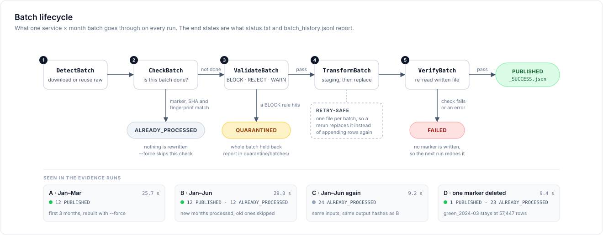
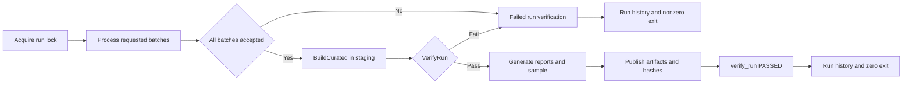

# Pipeline และ state machine

## ระดับ batch

DetectBatch ตรวจไฟล์บนเครื่องกับ SHA ใน manifest และ metadata จาก server ถ้า ETag/size เปลี่ยนจะ archive raw เดิมแล้วรับเวอร์ชันใหม่ Download เขียนเป็น `.part` ก่อน rename และ retry เมื่อ network/stream ไม่ครบ หาก HEAD/ETag ใช้ตรวจไม่ได้จะใช้ GET และเทียบเนื้อหา

CheckBatch ตรวจ marker, source SHA, reference SHA, processing fingerprint, trusted SHA, row count และความครบของ artifact ก่อนข้าม batch ส่วนการ reprocess ลบ marker เดิมก่อนเข้า gate

Raw ที่มาถึงยังไม่ถือว่าผ่านการยอมรับ แถว valid จะถูก standardize และเก็บ warning แถว reject ถูกแยกพร้อมเหตุผล ส่วนปัญหาที่เกิน threshold จะหยุดทั้ง batch

Transform เขียนผ่าน `data/trusted/_staging/{run_id}/...` แล้ว replace ชื่อไฟล์เดิม จึงไม่ append trip เดิมเมื่อ retry หลัง partial failure ถ้า VerifyBatch ล้มเหลว ไฟล์ที่เขียนอาจยังอยู่แต่ไม่มี marker และการรันใหม่จะเขียนแทนอีกครั้ง

## ระดับ run

PUBLISHED และ ALREADY_PROCESSED เป็นผลที่นำไปสร้าง curated ต่อได้ ระบบเลือกไฟล์ของ window โดยตรง ไม่อ่าน unmarked partitions หรือ staging รวมเข้าไป

VerifyRun ตรวจ counts จาก raw/trusted/quarantine, ความครบและ uniqueness ของ service–month, monthly counts ราย batch, borough totals และ baseline S1 เมื่อ scope ตรงกัน จากนั้นจึงสร้างและเผยแพร่ report พร้อม artifact SHA `verify_run.json` เป็น PASSED หลังขั้นตอนนี้ครบ

Run log บันทึก state transitions และ duration ส่วน batch history เก็บผลสำเร็จ/ข้าม/quarantine/failure ทุก batch ที่จบการทำงาน Run ID แยกการเรียกแต่ละครั้ง และ run lock ป้องกัน writer สอง process เขียนสถานะพร้อมกัน

การใช้ไฟล์ Parquet และ markers นี้ยังไม่มี transaction/snapshot ระดับทั้งตารางแบบ table format จึงต้องตรวจ run status ร่วมกับ artifact receipts
